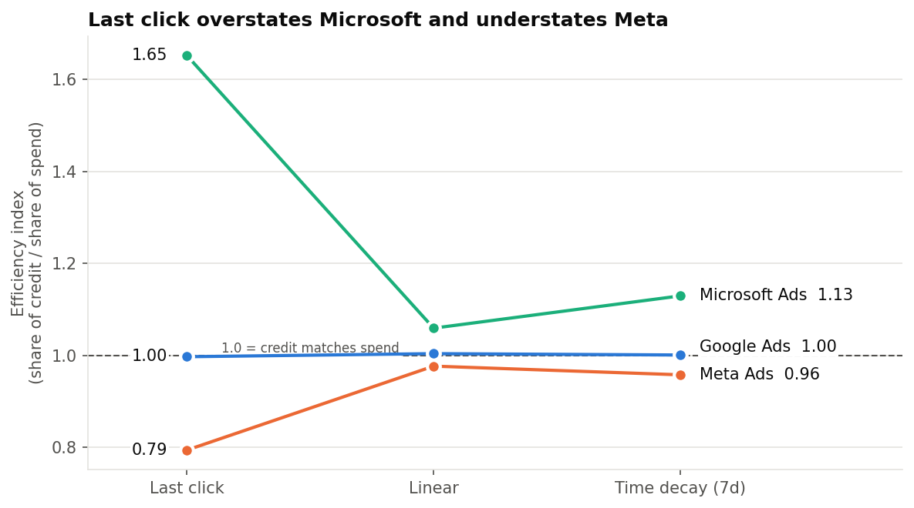
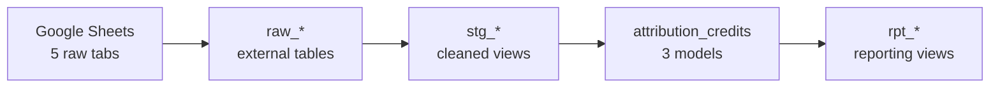
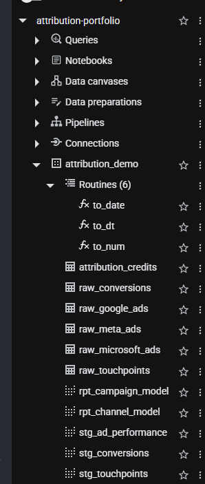
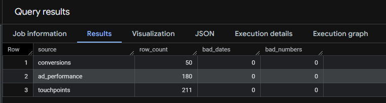
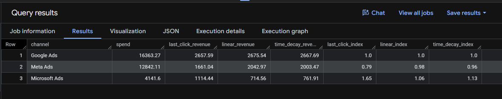

# Multi-Channel Attribution & ROAS Analysis

A BigQuery and Python pipeline that combines Google Ads, Meta Ads and Microsoft Ads data and compares three attribution models (last click, linear, time decay) to show how each one changes budget decisions.

**Key result:** judged on last click, Microsoft brand search looks 65% more efficient than its budget share and Meta prospecting looks 21% less. Once every click in the path gets credit, both move close to 1.0. Cutting Meta on last-click numbers would likely be a mistake.



📄 **[Read the findings write-up →](FINDINGS.md)** · **Tools:** BigQuery (SQL), Python (pandas, matplotlib), Google Sheets

**Why synthetic data:** I manage Google, Meta and Microsoft Ads accounts day to day, but client data is confidential. This dataset reproduces the problems I deal with in real exports: cost in micros, inconsistent campaign names, mixed date formats, and one channel reported under six different source labels.

---

## The business question

Every ad platform reports its own conversions, and together they claim far more sales than the business actually made. Each platform takes credit for the same customer. So which channel deserves more budget?

This project answers that by joining ad spend to actual orders and customer click paths, then testing how the answer changes under different attribution models.

## Data

Synthetic data built to look like real platform exports, including the problems you see in practice (30 days, July 2026):

| Table | Rows | Description | Data issues built in |
|---|---|---|---|
| `google_ads_raw` | 60 | Daily campaign performance | Cost reported in micros, fractional conversions |
| `meta_ads_raw` | 60 | Daily campaign performance | Inconsistent campaign name casing, trailing spaces |
| `microsoft_ads_raw` | 60 | Daily campaign performance | Dates in MM/DD/YYYY format |
| `touchpoints` | 211 | Ad clicks per user (80 users) | Same channel under 6+ source labels (`fb`, `Meta`, `google / cpc`, ...) |
| `conversions` | 50 | Orders with revenue | Not every user converts, some clicks fall outside the window |

## Pipeline



| Step | File | What it does |
|---|---|---|
| 1 | `01_external_tables.sql` | Reads the Google Sheet into BigQuery as external tables (all text) |
| 2 | `02_udfs.sql` | Reusable functions to parse numbers, dates and timestamps in several formats |
| 3 | `03_staging.sql` | Unifies the 3 platforms into one schema, converts micros, standardizes campaign names, maps source labels to channels |
| 4 | `04_data_quality_checks.sql` | Row counts and parse-failure checks |
| 5 | `05_attribution_models.sql` | Builds each customer's click path (30-day lookback) and assigns credit under each model |
| 6 | `06_reporting_views.sql` | Joins credited revenue to spend by campaign and channel; calculates ROAS, share of spend, share of credit |
| 7 | `07_model_comparison.sql` | Side-by-side comparison of the three models |



## Attribution models

- **Last click:** 100% of the credit goes to the final ad click before purchase.
- **Linear:** credit is split equally across every click in the path.
- **Time decay:** clicks closer to the purchase get more credit, with a 7-day half-life (a click 7 days before the order gets half the weight of a same-day click).

Window functions (`ROW_NUMBER`, `COUNT`, `SUM ... OVER`) handle the path logic, and `UNNEST` turns each touchpoint into one row per model.

## Data quality

Every source loads with the expected row count and zero parsing failures.



## Results

| Channel | Spend | Last click revenue | Linear revenue | Time decay revenue | Efficiency index (LC / Lin / TD) |
|---|---|---|---|---|---|
| Google Ads | $16,363 | $2,658 | $2,676 | $2,668 | 1.00 / 1.00 / 1.00 |
| Meta Ads | $12,842 | $1,661 | $2,043 | $2,003 | 0.79 / 0.98 / 0.96 |
| Microsoft Ads | $4,142 | $1,114 | $715 | $762 | 1.65 / 1.06 / 1.13 |

*Efficiency index = share of credited revenue ÷ share of spend. Above 1.0 means the channel earns more credit than its share of budget.*



## What this means for budget

- **Last click overvalues Microsoft brand search.** Brand search is often the final click before purchase, so last click gives it an index of 1.65. Under linear and time decay it drops to about 1.1, because those customers usually found the brand through another channel first.
- **Last click undervalues Meta prospecting.** Meta often starts the path but rarely closes it. Its credit rises by about 23% when earlier clicks count (index 0.79 → 0.98).
- **Google Ads holds steady** under every model, which suggests its share of budget is about right.
- **Recommendation:** don't cut Meta prospecting based on last-click reports. Use time decay as the default model for budget reviews, and test any reallocation with a holdout before scaling it.

*Note: the data is synthetic and the user sample is small, so absolute ROAS figures are not meaningful. The comparison between models is the point of the analysis.*

## Python version and charts

`python/attribution_charts.py` rebuilds the same pipeline in pandas from the CSVs in `/data`, checks it against the SQL results, and saves the charts below.


To run it: `pip install -r requirements.txt`, then `python python/attribution_charts.py` from the repo root. Or open Google Colab and run:

    !git clone https://github.com/paolofelix/multichannel-attribution-roas.git
    %cd multichannel-attribution-roas
    !python python/attribution_charts.py

## How to reproduce

1. Copy the 5 CSVs in `/data` into a Google Sheet, one tab each, using the same tab names.
2. In BigQuery (the free sandbox works), run `01_external_tables.sql` after replacing `YOUR_SHEET_ID` with your sheet's ID.
3. Run the remaining files in order (02 → 07).
4. `04_data_quality_checks.sql` should return 180 / 211 / 50 rows with zero parse failures.

## Repository structure

```
├── README.md
├── FINDINGS.md        # plain-language write-up of results
├── requirements.txt
├── sql/               # 7 BigQuery SQL files, run in order
├── python/            # pandas version, chart script and charts/
├── charts/            # charts generated by the Python script
├── data/              # synthetic source data (CSV)
└── screenshots/       # BigQuery query results
```

## About me

Paolo Felix: Data analyst with a background in finance operations and paid media analytics across Google, Meta and Microsoft Ads.
https://www.linkedin.com/in/paolo-stefano-b-felix/ · paolobfelix@gmail.com
